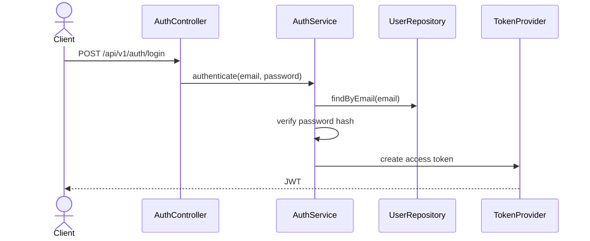

# Authentication and Authorization Design

## Authentication types

Human users authenticate with email and password and receive a short-lived JWT access token. Devices authenticate independently with a hashed device secret or API key.

## Request flow

## Authorization model

Access is project-based. A device belongs to a project, and a user's access to that device comes from project membership.

| Role | Read resources | Use devices | Modify devices | Manage members |
| --- | --- | --- | --- | --- |
| `VIEWER` | Yes | No | No | No |
| `MEMBER` | Yes | Yes | Limited | No |
| `ADMIN` | Yes | Yes | Yes | Yes |
| `OWNER` | Yes | Yes | Yes | Yes |

## Current implementation status

Authentication is not implemented yet. `SecurityConfig` currently uses `permitAll()`, so the endpoint rules in this document are the target behavior, not the current behavior.