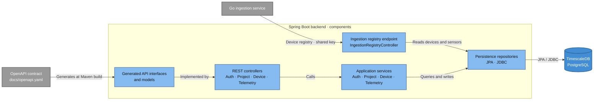

# Level 3: Spring backend components

The Spring backend serves the REST API: generated API interfaces route HTTP requests to controllers, which use application services and repositories to access the database. It does not consume MQTT on this branch; the Go ingestion service does, and reads the device registry from Spring's internal endpoint.

The source names are intentionally grouped where multiple related controller or repository classes share one responsibility. The OpenAPI file remains the API contract; generated code under `target/` is build output.
