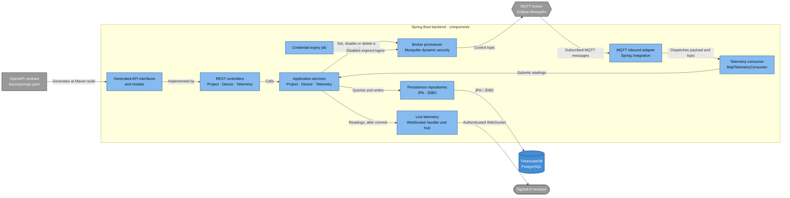

# Level 3: Spring backend components

The Spring backend has three input paths: generated REST API interfaces route HTTP requests to controllers, the MQTT inbound adapter forwards broker messages to the telemetry consumer, and a WebSocket handler streams stored readings to authorized browsers. Application services and repositories access the database, and a provisioner keeps each device's broker login in step with its credentials.

The source names are intentionally grouped where multiple related controller or repository classes share one responsibility. The OpenAPI file remains the API contract; generated code under `target/` is build output.
