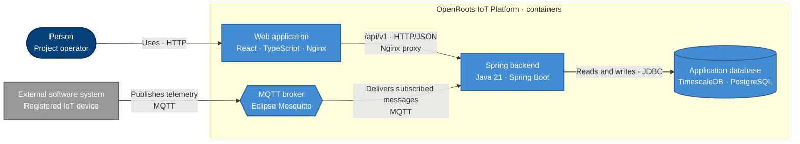

# level 2: containers

The platform runs as four application containers in Docker Compose. The browser loads the React UI from Nginx; Nginx serves the static app and proxies `/api/` requests to Spring Boot. Devices publish MQTT messages to Mosquitto, which Spring Boot consumes. The backend persists application and telemetry data in TimescaleDB/PostgreSQL.

The Compose host publishes the frontend on port `5173`, the backend on `8080`, the broker on `1883`, and the database on `5432` by default. These host ports can be overridden with the corresponding environment variables in `.env`.
