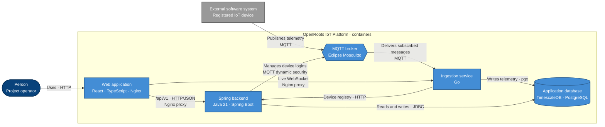

# level 2: containers

The platform runs as five application containers in Docker Compose. The browser loads the React UI from Nginx; Nginx serves the static app and proxies `/api/` requests to Spring Boot. Devices publish MQTT messages to Mosquitto; the Go ingestion service consumes them, validates them against the device registry it reads from Spring, and writes readings to TimescaleDB. It also streams new readings to open browsers over an authenticated WebSocket. Spring persists application data, serves telemetry reads, and keeps each device's MQTT login in step with its credentials.

The Compose host publishes the frontend on port `5173`, the backend on `8080`, the ingestion service on `127.0.0.1:8081`, the broker on `1883`, and the database on `5432` by default. These host ports can be overridden with the corresponding environment variables in `.env`.
