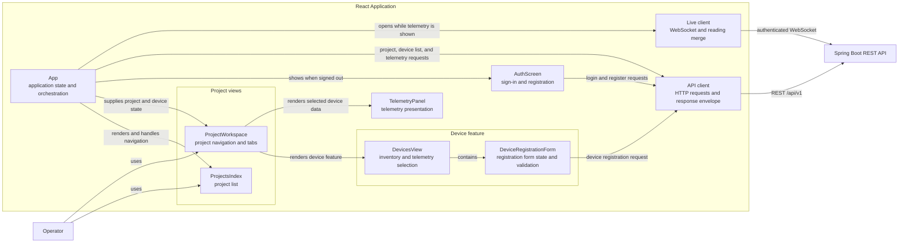

# Level 3:  Frontend components 

This view describes the React frontend currently implemented on `spring-mqtt-ingestion`. It focuses on the main UI and API boundaries rather than individual presentational elements.

## Responsibilities

- **App** owns the signed-in session, the selected project, loaded project/device data, telemetry selection, and calls that coordinate views.
- **AuthScreen** is shown while there is no access token. It signs users in or registers them and reports the token to `App`.
- **ProjectsIndex** presents projects, reports a user's project selection to `App`, and offers project creation to platform administrators.
- **ProjectWorkspace** presents project navigation and tabs, and coordinates the device and telemetry views.
- **DevicesView** presents the inventory and telemetry selection controls. Device names use explicit buttons to open telemetry.
- **DeviceRegistrationForm** owns registration input, client-side validation, submission state, and user feedback.
- **API client** centralizes the JSON response-envelope handling, the frontend's `/api/v1` endpoints, and sending the access token.
- **Live client** opens an authenticated WebSocket for the device whose telemetry is open and merges each new reading into the record list.
- **TelemetryPanel** presents telemetry records passed from the application state.

The device inventory continues to refresh every five seconds while its tab is open, and an open telemetry panel receives new readings as they are stored. This diagram describes frontend responsibilities; the authoritative HTTP contract remains [OpenAPI](../openapi.yaml).
