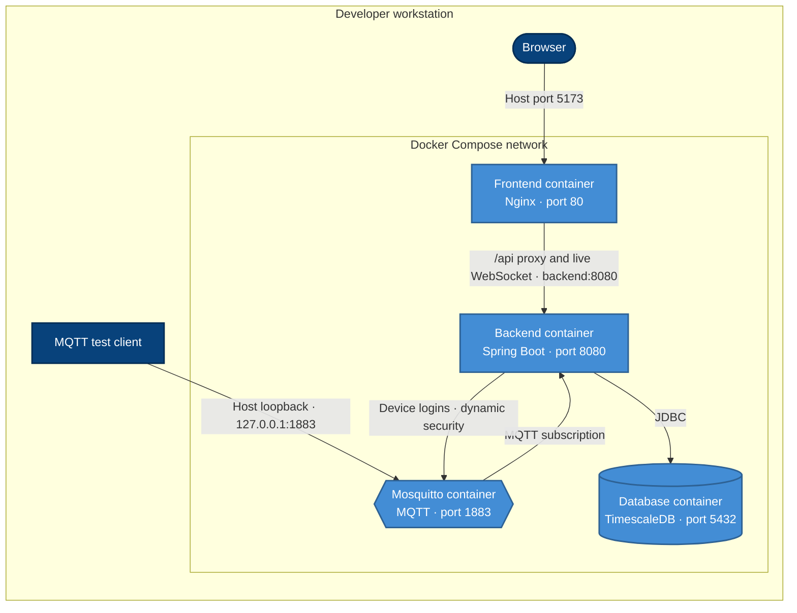

# Deployment view: Local Docker Compose

The local development deployment runs the platform containers on one Docker host. The browser and an optional MQTT test client run on the workstation outside the Compose network and connect through published host ports.

Published port values are defaults. Compose allows overrides through `.env`; the MQTT host binding defaults to `127.0.0.1`, so remote devices cannot reach it until `MQTT_BIND_ADDRESS` is changed.
