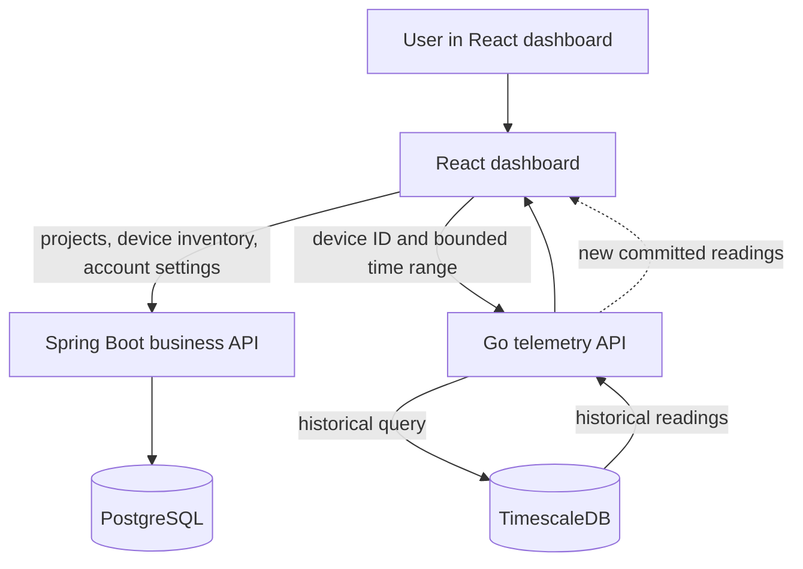

# Dynamic View: Request Paths

This is a proposed runtime request-flow view, not a C4 level 1, 2, or 3 diagram.
It shows how a future React dashboard could use the Spring Boot business API for
project and device-management operations while using a separate Go telemetry API
for bounded historical telemetry queries and live-reading updates.

The Spring Boot API and React frontend exist on the current branch. The Go
telemetry API, historical TimescaleDB query path, and dashed live-update path are
proposed and are not implemented in the current Compose deployment. The diagram
also includes account settings as a future frontend request category; user
authentication and account management are not currently enabled.

Use the implemented C4 views in the [architecture index](README.md) for the
current system boundaries, containers, and components. Use this view when
discussing the proposed separation between business requests and telemetry
queries.

