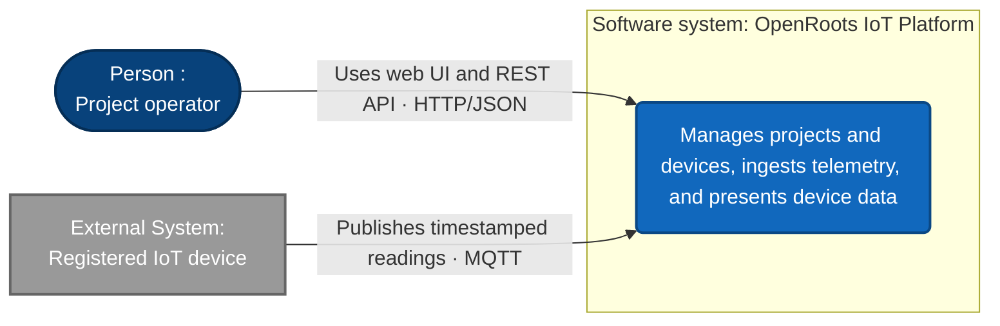

# Level 1: System Context

The system boundary covers the OpenRoots platform. People use the web interface to inspect projects, register devices, and view telemetry. Registered devices publish telemetry through MQTT.

Authentication is not currently enforced by the Spring security configuration; see [authentication status](../security/authentication.md).
