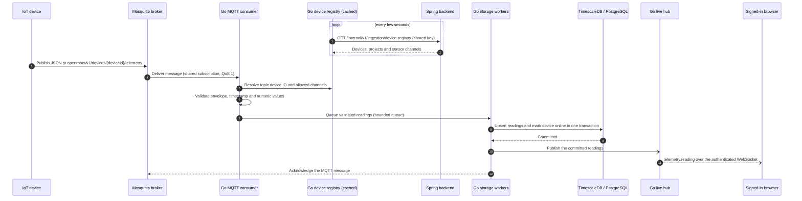

# Dynamic View: MQTT Telemetry Ingestion

This view follows one telemetry publication through the Go ingestion service (`ingestion/`). Spring does not subscribe to MQTT on this branch. Go keeps an in-memory copy of the registered devices and sensors, refreshed from the backend's internal registry endpoint, so it never calls Spring per message.

The message body is `{"capturedAt": ..., "payload": {...}}`. The topic identifies the device, so a body `deviceId` is rejected as an unexpected field. See the [telemetry contract](../contracts/mqtt-telemetry.md) for every validation rule and the storage mapping, and [`ingestion/README.md`](../../ingestion/README.md) for configuration.
