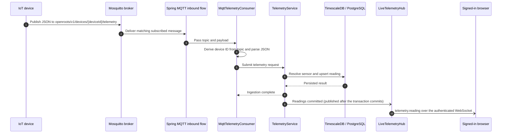

# Dynamic View: MQTT Telemetry Ingestion

This view follows one telemetry publication through the current Spring MQTT integration, including the live push to browsers that are watching the device. The broker subscription is configured in `MqttConfig`; `MqttTelemetryConsumer` derives the device UUID from the topic, parses the payload, and passes the reading to `TelemetryService` for storage.

The current MQTT request uses `deviceId`, `capturedAt`, and a channel-to-value `payload`. The broker topic also carries a device ID; the consumer rejects a body `deviceId` that disagrees with the topic. See the implementation in `MqttTelemetryConsumer` and the [telemetry contract](../contracts/mqtt-telemetry.md) for the distinction between current behavior and stricter design requirements.
