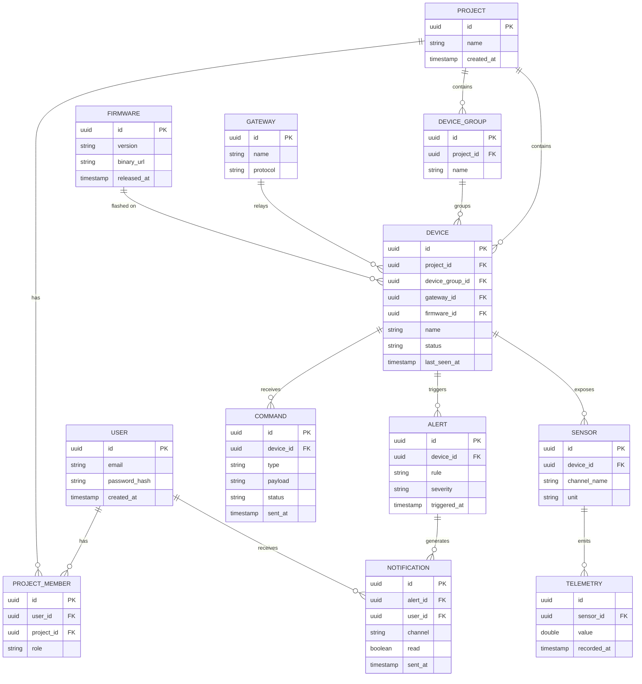

# Domain Data Model

## Architecture view: domain/data model

This document describes the relational domain model represented by the current
database migrations. It is a data model view, not a C4 Level 1, Level 2, or
Level 3 diagram.

The schema contains the foundation for projects, project membership, devices,
sensors, telemetry, commands, alerts, notifications, gateways, and firmware.
The database tables exist in the current migrations, but the REST API,
frontend, authentication, command dispatch, and alert workflows do not expose
all of these entities yet.

The current implemented frontend/backend workflow primarily uses:

```text
PROJECT -> DEVICE -> SENSOR -> TELEMETRY
```

## Entity relationship diagram



## Entity responsibilities

| Entity | Responsibility | Current status |
|---|---|---|
| `USER` | Human identity and password hash | Database table exists; authentication is not active |
| `PROJECT` | Operational workspace that owns devices | Used by the current REST API and frontend |
| `PROJECT_MEMBER` | User/project relationship and role | Database table exists; authorization is not active |
| `DEVICE_GROUP` | Optional grouping of devices inside a project | Database table exists; not exposed by the current UI |
| `GATEWAY` | Gateway or relay associated with devices | Database table exists; not exposed by the current UI |
| `FIRMWARE` | Firmware release metadata | Database table exists; update workflow is not implemented |
| `DEVICE` | Registered physical device | Used by the current REST API and frontend |
| `SENSOR` | Named measurement channel belonging to a device | Used by device registration and telemetry |
| `TELEMETRY` | Time-series measurement for a sensor | Stored by MQTT ingestion and listed through the API |
| `COMMAND` | Device command and delivery status | Database table exists; command dispatch is not implemented |
| `ALERT` | Device alert generated from a rule | Database table exists; alert evaluation is not implemented |
| `NOTIFICATION` | Alert delivery record for a user | Database table exists; notification delivery is not implemented |

## Relationships and constraints

- A project can contain many devices.
- A device belongs to one project.
- A device can expose many sensors.
- A sensor belongs to one device.
- A device's `channel_name` values are unique through the `(device_id, channel_name)` constraint.
- A sensor can produce many telemetry records.
- Telemetry uses `(sensor_id, recorded_at)` as its primary key for time-series uniqueness.
- Deleting a project cascades to its devices through the project foreign key.
- Deleting a device cascades to its sensors, telemetry, commands, and alerts.
- Device-group, gateway, and firmware associations are nullable and use `ON DELETE SET NULL`.
- Alerts can generate many notifications.
- Notifications reference both the alert and the receiving user.

## Physical storage

The schema is created by:

- [`V1__init.sql`](../../src/main/resources/db/migration/V1__init.sql) — creates the relational tables, foreign keys, uniqueness constraints, and indexes.
- [`V2__timescale_telemetry.sql`](../../src/main/resources/db/migration/V2__timescale_telemetry.sql) — enables TimescaleDB, converts `telemetry` into a hypertable, and adds query indexes.
- [`V3__device_registration_fields.sql`](../../src/main/resources/db/migration/V3__device_registration_fields.sql) — adds `device_type` and `registered_at` fields required by device registration.

The generated OpenAPI models describe the API-facing subset of this schema.
They should not be treated as a complete representation of every database
table.

## Scope and implementation status

This model is broader than the current user-facing application. It documents
the intended domain foundation while the current working path is project,
device, sensor, and telemetry management.

For current runtime boundaries, use the [C4 architecture views](README.md).
For the API contract, use the [OpenAPI document](../openapi.yaml). For the
frontend implementation, use the [frontend A-to-Z guide](../frontend/frontend-a-z-guide.md).
