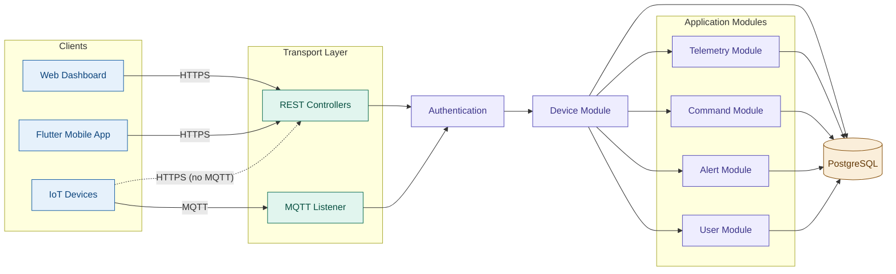

# Ingress Flow (dynamic view)

This shows how external clients enter the platform through REST and MQTT, pass through authentication and application modules, and reach PostgreSQL.

The view spans C4 abstractions rather than representing one C4 level:

- **C2 containers:** REST controllers, MQTT listener, and PostgreSQL.
- **C3 components/modules:** authentication, device, telemetry, command, alert, and user modules.

For the implemented MQTT path, see  [MQTT telemetry ingestion (dynamic view)](c4-telemetry-ingestion.md).

