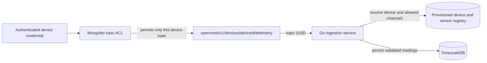

# Telemetry MQTT Contract

> **Status:** Proposed for the first Go/MQTT integration. This is a wire contract to implement; the current application still ingests telemetry through the Spring HTTP API.

## MQTT topic

```text
openroots/v1/devices/{deviceId}/telemetry
```

Where `{deviceId}` is the registered device UUID in lowercase canonical UUID form, for example:

```text
openroots/v1/devices/7e2b2dc8-43c1-4e1f-b1ba-fd67d098f1a2/telemetry
```

The `v1` topic level versions the message contract. A device publishes only to its own exact topic namespace. Mosquitto ACLs must bind each authenticated device credential to that device's topic; the Go subscriber may subscribe to the fleet wildcard, but device credentials must not publish through a wildcard or to another device's topic.

Go derives the device identity from the UUID in the ACL-protected topic and resolves it against trusted device provisioning data. It does not trust an identity claimed in the payload. Ordinary MQTT delivery gives subscribers the topic and payload, not necessarily the publisher's username.

Telemetry messages are event data, so publishers set the MQTT retained flag to `false`. The database is the source for historical readings. A retained “latest state” topic, if needed later, should be designed separately.

## Payload

The first version uses JSON UTF-8 and follows the current Spring telemetry request's timestamp and channel-value vocabulary, while omitting `deviceId` because the topic identifies the device:

```json
{
  "capturedAt": "2026-10-17T13:45:00Z",
  "payload": {
    "temperature": 22.4,
    "rain": 0.0,
    "uv": 3
  }
}
```

### Fields

| Field | Required | Rule |
|---|---:|---|
| `capturedAt` | Yes | Measurement time as an RFC 3339 timestamp with an explicit UTC offset. Normalize to UTC for storage. Do not silently replace a missing timestamp with server receive time. |
| `payload` | Yes | Non-empty JSON object mapping registered `sensor.channel_name` values to numeric readings. |

The payload does not carry a device ID, project ID, unit, or schema selected by the device. Those values come from the topic and trusted registration/provisioning data. Units are already defined on the registered sensor.

## Validation rules

The Go service rejects a message before storage when any of these conditions holds:

- The topic does not match the exact versioned device telemetry format or contains an invalid/unregistered UUID.
- The topic's device is unknown, its credential has been revoked, or it is not authorized for that topic according to trusted provisioning data.
- The JSON is malformed, contains duplicate object keys, or contains unexpected top-level fields.
- `capturedAt` is missing, malformed, or has no explicit timezone offset.
- `payload` is missing, empty, or not an object.
- A channel is not assigned to that device, or a value is not a JSON number.
- A reading cannot be represented as a finite `DOUBLE PRECISION` value.

Channel names are exact and case-sensitive matches for the device's registered `sensor.channel_name`. A message may contain a subset of the device's channels; it must contain at least one. Extra/unregistered channels are rejected rather than silently ignored. Sensor-specific minimum/maximum ranges and clock-skew limits are not represented in the current schema and remain future contract extensions.

## Storage mapping and retries

Each channel/value pair becomes one telemetry row:

| MQTT field | TimescaleDB column/source |
|---|---|
| UUID in topic | Resolve `sensor.id` by matching `sensor.device_id` |
| `payload` key | `sensor.channel_name` |
| `payload` number | `telemetry.value` |
| `capturedAt` | `telemetry.recorded_at` |

The current schema keys telemetry by `(sensor_id, recorded_at)`, and the current Spring repository updates the existing value when that pair conflicts. The Go writer should preserve this idempotent retry behavior for the first version: replaying a channel reading with the same device, channel, and timestamp updates that point rather than creating a duplicate row. A different deduplication policy would require an explicit schema/contract change.

The first version does not add a `messageId`; the existing storage key is the retry identity per channel. MQTT QoS, acknowledgement timing, retry limits, and backpressure behavior remain implementation decisions and must be selected before the broker consumer is built.

## Device-to-schema mapping

Spring remains the source of registered device and sensor metadata. For the first integration, Go must resolve the topic UUID to a registered device, check its credential/provisioning status, and load that device's allowed channel names. The mapping source and refresh/revocation behavior must be selected before implementing the integration; Go must not call the Spring API synchronously for every message.

The ACL-protected topic and the Spring-managed registration together establish identity and allowed schema:



## Example rejection cases

- Device A publishes to Device B's topic: Mosquitto denies the publication; Go does not store it.
- A valid device topic contains `"deviceId": "..."` in the JSON body: reject the unexpected field; topic identity is authoritative.
- A device registered for `temperature` and `rain` sends `"humidity": 64`: reject the unassigned channel.
- A sensor sends `"temperature": "22.4"`: reject the string value; numeric strings are not coerced.
- A message has `"capturedAt": "2026-10-17T13:45:00"`: reject it because it has no explicit timezone.

## Deferred extensions

- Per-sensor numeric bounds and calibration metadata.
- A `messageId` if deduplication must span timestamps or message batches.
- Binary encodings if measurements show JSON parsing or bandwidth is a real constraint.
- Version `v2` for incompatible envelope changes.
- Retained latest-state topics, commands, and device status messages.
