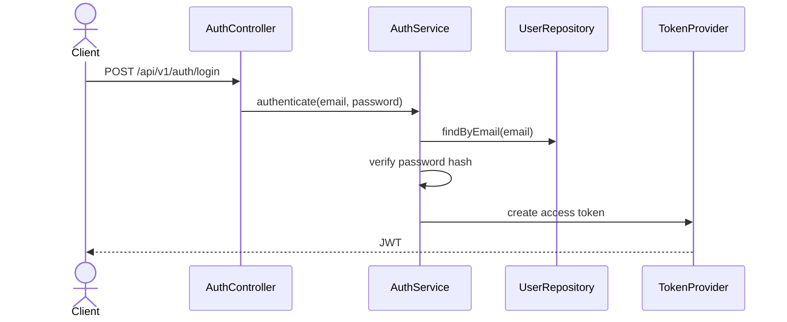

# Authentication and Authorization Design

## Authentication types

Human users authenticate with email and password and receive a short-lived JWT access token. Devices authenticate independently with a hashed device secret or API key.

## Request flow

## Authorization model

Access is project-based. A device belongs to a project, and a user's access to that device comes from project membership.

| Role | Read resources | Use devices | Modify devices | Manage members |
| --- | --- | --- | --- | --- |
| `VIEWER` | Yes | No | No | No |
| `MEMBER` | Yes | Yes | Limited | No |
| `ADMIN` | Yes | Yes | Yes | Yes |
| `OWNER` | Yes | Yes | Yes | Yes |

## Role semantics

| Operation | Minimum role |
| --- | --- |
| Read project, devices, telemetry, members | `VIEWER` |
| Ingest telemetry over REST ("use devices") | `MEMBER` |
| Register or delete devices; create, rotate, revoke and list device credentials | `ADMIN` |
| Add, change or remove members | `ADMIN` |
| Grant, change or remove the `OWNER` role | `OWNER` |

- "Limited" device modification for `MEMBER` is resolved as **none**: a member can use devices (send telemetry) but cannot register or delete them or manage their credentials.
- A project must always keep at least one `OWNER` (BR-004); the last owner cannot be demoted or removed.
- The creator of a project becomes its `OWNER`.

## HTTP status semantics

| Status | When |
| --- | --- |
| `401` | No token, malformed/tampered/expired token, or bad login credentials. Login failures use one message for unknown email and wrong password (BR-003). |
| `403` | The caller is a project member but their role does not permit the operation. |
| `404` | The caller is not a member of the project, or the resource does not exist. These are indistinguishable (BR-010). |

## Public routes

`POST /api/v1/auth/register`, `POST /api/v1/auth/login`, `/actuator/health`, `/actuator/info`, `/v3/api-docs/**`, `/swagger-ui/**`. Every other route requires `Authorization: Bearer <jwt>`.

## Configuration

| Property | Env var | Notes |
| --- | --- | --- |
| `openroots.jwt.secret` | `OPENROOTS_JWT_SECRET` | Base64 HMAC key, at least 32 bytes. **No default** outside the `dev` profile; the application will not start without it. |
| `openroots.jwt.expiration` | `OPENROOTS_JWT_EXPIRATION` | ISO-8601 duration, default `PT15M`. |

Generate a key with `openssl rand -base64 48`.

## Device credentials

A credential belongs to one device. The secret is random, returned **only** in the create or rotate response, and stored as a BCrypt hash. Listing credentials returns metadata only (`id`, `name`, `createdAt`, `expiresAt`, `revokedAt`, `active`). Rotation revokes the old credential and issues a replacement with the same name and expiry; the device identity does not change. Revoked or expired credentials are inactive (BR-013).

## Current implementation status

Implemented:

- Registration and login with BCrypt-hashed passwords and short-lived JWT access tokens.
- Stateless JWT filter; every route except the public ones requires authentication.
- Project creation (creator becomes `OWNER`), membership management and project-level authorization for projects, devices and telemetry (REST).
- Device credential creation, listing, rotation and revocation with hashed secrets.

Not implemented yet:

- **Devices authenticating with their credentials.** Credentials can be issued and revoked, but nothing verifies them yet: the REST telemetry endpoint requires a human JWT, and the MQTT consumer ingests without checking a device credential (broker-level MQTT authentication is configured separately in `mosquitto/`).
- Refresh tokens, logout/token revocation, password reset, and email verification.
- Authentication for the WebSocket push (`WebSocketConfig` is currently empty).
