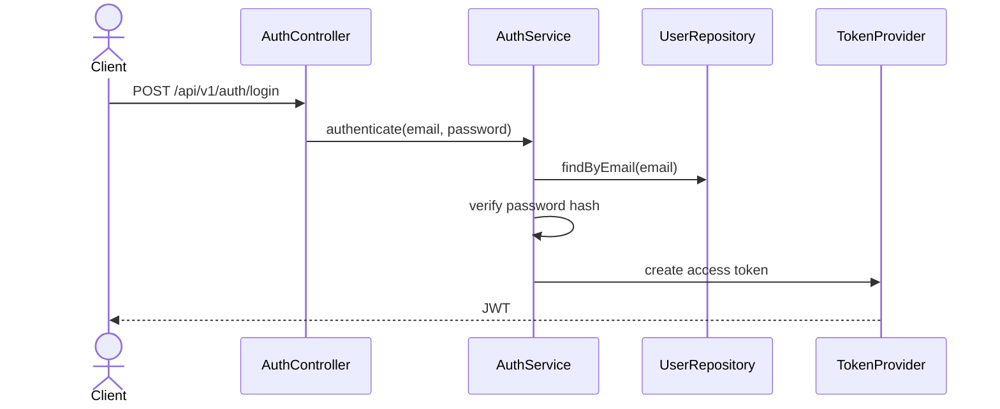

# Authentication and Authorization Design

## Authentication types

Human users authenticate with email and password and receive a short-lived JWT access token. Devices authenticate independently with a hashed device secret or API key.

## Request flow

## Platform roles

Every account also has a platform-wide role, stored in `user.platform_role`. It is separate from project roles.

| Platform role | Can do |
| --- | --- |
| `USER` (default for every registration) | Log in and see only the projects they have been added to. A new user's dashboard is empty until a project owner or admin adds them. |
| `ADMIN` | Everything a `USER` can, plus create projects (becoming their `OWNER`), list all accounts, and promote or demote other users' platform role. |

- The platform must always keep at least one `ADMIN`; demoting the last one is rejected.
- The platform role is read from the database on every check, so a demotion takes effect immediately, not when the token expires.
- Admin endpoints: `GET /api/v1/admin/users`, `PUT /api/v1/admin/users/{userId}/platform-role`. `GET /api/v1/auth/me` returns the caller's own id, email and platform role.

### Bootstrapping the first admin

1. Set `OPENROOTS_BOOTSTRAP_ADMIN_EMAIL` and `OPENROOTS_BOOTSTRAP_ADMIN_PASSWORD` (8+ characters) in the server's `.env`.
2. Start the stack. When no `ADMIN` exists, the backend creates that account with a BCrypt-hashed password and the `ADMIN` role, and logs that it did.
3. Log in as that account.
4. Remove `OPENROOTS_BOOTSTRAP_ADMIN_PASSWORD` from `.env`. Once an admin exists the bootstrap does nothing, so the email may stay.

If the bootstrap email is already registered as a normal account, it is **not** promoted and an error is logged. Otherwise anyone who registered that address first would inherit admin rights. Use a different email or promote the account from an existing admin.

## Authorization model

Access is project-based. A device belongs to a project, and a user's access to that device comes from project membership.

| Role | Read resources | Use devices | Modify devices | Manage members |
| --- | --- | --- | --- | --- |
| `VIEWER` | Yes | No | No | No |
| `MEMBER` | Yes | Yes | Limited | No |
| `ADMIN` | Yes | Yes | Yes | Yes |
| `OWNER` | Yes | Yes | Yes | Yes |

## Role semantics

| Operation | Minimum role |
| --- | --- |
| Read project, devices, telemetry, members | `VIEWER` |
| Ingest telemetry over REST ("use devices") | `MEMBER` |
| Register or delete devices; create, rotate, revoke and list device credentials | `ADMIN` |
| Add, change or remove members | `ADMIN` |
| Grant, change or remove the `OWNER` role | `OWNER` |

- "Limited" device modification for `MEMBER` is resolved as **none**: a member can use devices (send telemetry) but cannot register or delete them or manage their credentials.
- A project must always keep at least one `OWNER` (BR-004); the last owner cannot be demoted or removed.
- Only a platform `ADMIN` may create projects. The creator of a project becomes its `OWNER`.

## HTTP status semantics

| Status | When |
| --- | --- |
| `401` | No token, malformed/tampered/expired token, or bad login credentials. Login failures use one message for unknown email and wrong password (BR-003). |
| `403` | The caller is a project member but their role does not permit the operation, or a non-admin called an admin-only route (project creation, `/api/v1/admin/**`). |
| `404` | The caller is not a member of the project, or the resource does not exist. These are indistinguishable (BR-010). |

## Public routes

`POST /api/v1/auth/register`, `POST /api/v1/auth/login`, `/actuator/health`, `/actuator/info`, `/v3/api-docs/**`, `/swagger-ui/**`. Every other route requires `Authorization: Bearer <jwt>`.

## Configuration

| Property | Env var | Notes |
| --- | --- | --- |
| `openroots.jwt.secret` | `OPENROOTS_JWT_SECRET` | Base64 HMAC key, at least 32 bytes. **No default** outside the `dev` profile; the application will not start without it. |
| `openroots.jwt.expiration` | `OPENROOTS_JWT_EXPIRATION` | ISO-8601 duration, default `PT15M`. |
| `openroots.bootstrap.admin.email` | `OPENROOTS_BOOTSTRAP_ADMIN_EMAIL` | First platform admin. Empty skips the bootstrap. |
| `openroots.bootstrap.admin.password` | `OPENROOTS_BOOTSTRAP_ADMIN_PASSWORD` | 8+ characters. Remove after the first login. |
| (Spring profile) | `SPRING_PROFILES_ACTIVE` | Compose defaults to `prod`. Set `dev` only on a local machine: it seeds a demo account. |

Generate a key with `openssl rand -base64 48`.

## Device credentials

A credential belongs to one device. The secret is random, returned **only** in the create or rotate response, and stored as a BCrypt hash. Listing credentials returns metadata only (`id`, `name`, `createdAt`, `expiresAt`, `revokedAt`, `active`). Rotation revokes the old credential and issues a replacement with the same name and expiry; the device identity does not change. Revoked or expired credentials are inactive (BR-013).

**Broker login.** Each device has one Mosquitto login: the username is the device UUID and the password is the most recently issued credential secret. The login has the `device-publisher` role, so it can publish only to that device's topic. The backend applies changes through Mosquitto's dynamic-security API and fails the request if the broker does not confirm the change:

- Creating or rotating a credential sets the broker password to the new secret.
- Revoking the device's newest credential (the one the broker holds) disables the broker login until a new credential is issued. Revoking an older credential changes nothing on the broker, because its secret was already replaced.
- When the newest credential expires, a background job disables the broker login within a minute (`OPENROOTS_MQTT_EXPIRY_CHECK_INTERVAL`, default `PT1M`). After a restart it applies any expiries it missed.
- If the broker does not confirm a change, the API answers `503` and nothing is saved.

Only the newest credential works on the broker. Older credentials can still show as active in the credential list, but the device cannot connect with them.
- Deleting a device deletes its broker login.

Verified against Mosquitto 2.1 with the production ACL defaults: after each step, only the password that the backend last set is accepted; a revoked or deleted device is refused, and a publish to another device's topic is denied.

**Caveat for device firmware.** Mosquitto denies a publish outside the device's topic with reason code 0x87 (Not authorized) on MQTT 5. On MQTT 3.1.1 the PUBACK has no reason code, so the broker acknowledges the publish and silently drops it. Devices should publish over MQTT 5, or check the topic they use, because a 3.1.1 acknowledgement does not prove the message was accepted.

Set `OPENROOTS_MQTT_PROVISIONING_ENABLED=true` (Compose does this) to turn sync on. When it is off, credentials exist only in the database.

## Current implementation status

Implemented:

- Registration and login with BCrypt-hashed passwords and short-lived JWT access tokens.
- Stateless JWT filter; every route except the public ones requires authentication.
- Platform roles (`USER`, `ADMIN`), a bootstrap admin from the environment, and admin endpoints for listing users and changing platform roles.
- Project creation by platform admins (creator becomes `OWNER`), membership management and project-level authorization for projects, devices and telemetry (REST).
- Device credential creation, listing, rotation and revocation with hashed secrets.
- Live telemetry WebSocket: the client sends its access token as the first message, the read rule is checked, and the socket closes when the token expires. See the [live telemetry contract](../contracts/live-telemetry.md).

Not implemented yet:

- **Verifying device credentials in the backend.** The broker verifies each device's synced login and enforces topic ownership. The backend does not check the database hash of a device credential on MQTT messages.
- Refresh tokens, logout/token revocation, password reset, and email verification.
- Invitations for emails that have not registered yet, and screens for member and user management.
- Rate limiting on `/api/v1/auth/*`.
